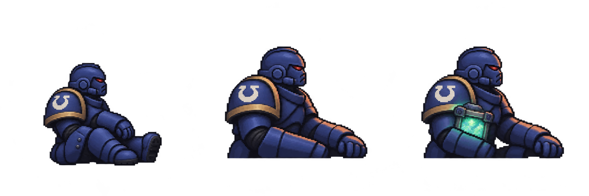

# 阿斯塔特｜未知伤亡模组

扮演一名极限战士战团的阿斯塔特，穿上蓝金 Mk X 动力甲，带着爆弹枪和链锯剑深入《Casualties: Unknown》的洞穴与实验室。安装后，在新局选角界面选择第四位 **「[AST-01] 阿斯塔特」**。 [Steam 游戏页面](https://store.steampowered.com/app/4576490/)



## 角色与开局装备

- **强化体质。** 初始力量、韧性和智力分别为 **34 / 32 / 28**，血容量 **9 L**，体力上限为原版的 **10 倍**。伤口和骨折愈合更快，免疫毒液、感染与败血症，食物等来源的患病增量为原版的 10%。
- **六件 Mk X 动力甲。** 头盔、胸腹甲、肩甲、臂甲与手甲、腿甲与战靴、动力背包均可在穿戴栏单独卸下。角色本体与装备的加成分别结算。穿上动力背包会自动打开泛光灯，并提高跑速。
- **爆弹枪与链锯剑。** 开局主手持全自动爆弹枪，副手持链锯剑。枪内有 60 发爆弹，背包里还有两个 60 发备用弹匣。链锯剑可按住攻击连续挥砍，命中怪物后的基础冷却约为 **0.185 秒**。
- **专属外观、台词和音效。** 裸装、动力甲、过场和死亡画面都有阿斯塔特的像素美术。包扎、注射和取异物等操作使用人手贴图。角色有中英台词及低沉男声音效，戴上头盔后，常规发声带有通讯滤波。按 **B**（默认键位）喊出 **「For the Emperor!」**。

## 第二心脏与贝利撒留炉

| 器官 | 触发条件 | 效果 |
| :--- | :--- | :--- |
| **贝利撒留炉** | 血量低于 65% 且仍在净失血，或脑健康降到 15/100 及以下并伴有头部骨折、破片或严重肌肉损伤 | 排出破片、止住内外出血、缓解疼痛和休克，修复仍有活性的肢体骨折和脱臼。 |
| **第二心脏** | 脑健康归零，死亡结算开始前 | 恢复循环和意识，将血量补到至少 80%。 |

两个器官每局各能启动一次，触发时有提示，使用状态随读档和换层恢复。升级至 2.4.3 时，已有的正式版阿斯塔特存档可以继续使用，两个器官首次读档时均处于待命状态。

## 安装

**模组版本 2.4.3** 已在 Windows 上的 Steam 正式版 **Build 26590676** 验证，使用 **BepInEx 5 x64**。装有 QoL Unknown 1.1.1 的环境也通过了读档和换层测试。

1. 在 Steam 库打开游戏的「管理 → 浏览本地文件」。如尚未安装 BepInEx，把 BepInEx 5 x64 解压到 `CasualtiesUnknown.exe` 所在目录，然后启动游戏一次以初始化。 [BepInEx 安装指南](https://docs.bepinex.dev/v5.4.21/articles/user_guide/installation/index.html)
2. 退出游戏，将构建好的 `AstartesMod.dll`、`modinfo.json` 和整个 `Sprites` 文件夹放到游戏目录的 `BepInEx/plugins/AstartesMod/`。
3. 重新启动游戏。开始新局时选择 **「[AST-01] 阿斯塔特」**，或者读取已有的阿斯塔特存档。新局发放初始装备，读档恢复当前装备、耐久和弹药。

```text
BepInEx/plugins/AstartesMod/
├── AstartesMod.dll
├── modinfo.json
└── Sprites/
```

## 从源码构建

安装 .NET SDK 和 BepInEx 后，在本项目根目录运行以下命令。把 `GameDir` 改成你的游戏安装目录。

```powershell
dotnet build .\AstartesMod\AstartesMod.csproj -c Release '-p:GameDir=D:\SteamLibrary\steamapps\common\Casualties Unknown'
```

构建产物在 `AstartesMod/bin/Release/`。游戏首次加载模组后，可以在 `BepInEx/config/casualtiesunknown.astartes-mod.cfg` 的 `[Astartes]` 节中调整初始技能、跑速、起跳、体力恢复、凝血和裸装防护。 [完整数值和存档说明](AstartesMod/README.md)

## 制作与素材

模组作者为 **lumoren**。这是为《Casualties: Unknown》制作的《Warhammer 40,000》同人模组。角色、装备和过场美术使用 ImageGen 制作，配音与动作音效的来源和署名见素材说明。 [美术参考与提示词](AstartesMod/Art/prompt.md) · [音效来源与署名](AstartesMod/Audio/SOURCES.md)
