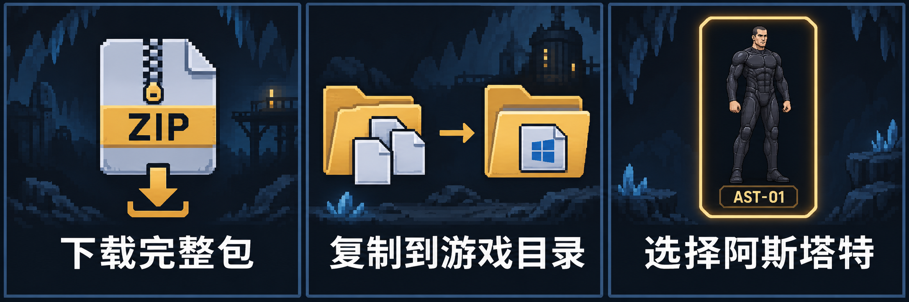

# 阿斯塔特下载与安装

适用于 Windows 64 位上的 Steam 正式版《Casualties: Unknown》，验证版本为 **Build 26590676**。准备好已安装的游戏和 Windows 自带的文件资源管理器即可。



## 1. 下载一个 ZIP

| 你的情况 | 下载 |
| --- | --- |
| 第一次装模组，或还没装 BepInEx | **[下载 Windows 完整包](https://github.com/bilbillm/casualties-unknown-astartes/releases/latest/download/AstartesMod-Windows-x64-Full.zip)**。含阿斯塔特和 BepInEx 5.4.23.4 x64。 |
| 已经能在这里用 BepInEx 5 x64 加载模组 | [下载仅模组包](https://github.com/bilbillm/casualties-unknown-astartes/releases/latest/download/AstartesMod-Mod-Only.zip)。 |

也可以打开 [GitHub 发布页](https://github.com/bilbillm/casualties-unknown-astartes/releases/latest)，展开 **Assets**，下载 `AstartesMod-Windows-x64-Full.zip` 或 `AstartesMod-Mod-Only.zip`。列表里的 `Source code` 是开发用源码。

## 2. 打开游戏目录

1. 先退出正在运行的游戏。
2. 打开 Steam，点顶部的 **库**。
3. 在左边的游戏列表右键 **Casualties: Unknown**，点 **管理 → 浏览本地文件**。
4. Steam 会打开一个文件夹。看到 **`CasualtiesUnknown.exe`** 或类型为「应用程序」的 **`CasualtiesUnknown`** 后，把这个窗口留着。

## 3. 解压并复制

1. 打开 Windows 的 **下载** 文件夹，右键刚下载的 ZIP，选 **全部解压缩**，再点 **提取**。
2. 打开解压完成的文件夹，看到 **`BepInEx`** 文件夹后，按 **Ctrl+A** 全选，再按 **Ctrl+C** 复制。
3. 切回 Steam 刚才打开的游戏目录。在 `CasualtiesUnknown.exe` 所在的那一层按 **Ctrl+V**。如果提示合并文件夹或替换同名文件，选择合并并替换。

复制后，核对下列位置。完整包还会把 `winhttp.dll` 和 `doorstop_config.ini` 放在游戏程序旁边。

```text
Casualties Unknown/
├── CasualtiesUnknown.exe
└── BepInEx/
    └── plugins/
        └── AstartesMod/
            ├── AstartesMod.dll
            ├── modinfo.json
            └── Sprites/
```

## 4. 进游戏检查

回到 Steam 点 **开始游戏**。第一次启动时等主菜单加载完成。点 **新游戏**，在选角界面选择第四位 **「[AST-01] 阿斯塔特」**，再点 **开始冒险**。进入游戏后，主手是爆弹枪，副手是链锯剑，穿戴栏里有六件 Mk X 动力甲。默认按 **B** 播放战吼。

使用其他角色时，可以在原版制作菜单里搜索 `Mk X`、`阿斯塔特` 或 `爆弹`。[查看十种装备、武器和弹药的配方](../AstartesMod/README.md#制作配方)

## 常见问题

| 现象 | 处理方法 |
| --- | --- |
| 解压后只有 `.cs`、`.csproj` 等源码文件 | 回到 [发布页](https://github.com/bilbillm/casualties-unknown-astartes/releases/latest)，从 **Assets** 下载上面列出的安装包。 |
| 找不到阿斯塔特选项 | 先核对 `BepInEx/plugins/AstartesMod/AstartesMod.dll` 和同级的 `Sprites`。目录多了一层压缩包名或额外的 `BepInEx` 时，按第 3 步重新复制解压出来的内容。 |
| 启动后没有 `BepInEx/LogOutput.log` | 检查 `winhttp.dll`、`doorstop_config.ini` 是否和 `CasualtiesUnknown.exe` 同级。初次安装请选择完整包。 |
| 目录正确但仍无法加载 | 打开 `BepInEx/LogOutput.log`，搜索 `Astartes Mod`。反馈时附上游戏版本和相关错误行。 |
| 已装旧版，想更新 | 先退出游戏。已经在用 BepInEx 5 x64 的玩家选仅模组包，按相同步骤复制并替换同名文件。检查 `BepInEx/plugins/` 下只有一份 `AstartesMod.dll`。 |
| 想卸载 | 退出游戏，移除 `BepInEx/plugins/AstartesMod/` 文件夹。需要继续读取阿斯塔特存档时，先装回模组。 |

完整包中的引导器来自 [BepInEx 5.4.23.4 官方发布](https://github.com/BepInEx/BepInEx/releases/tag/v5.4.23.4)。 [返回模组介绍](../README.md)
